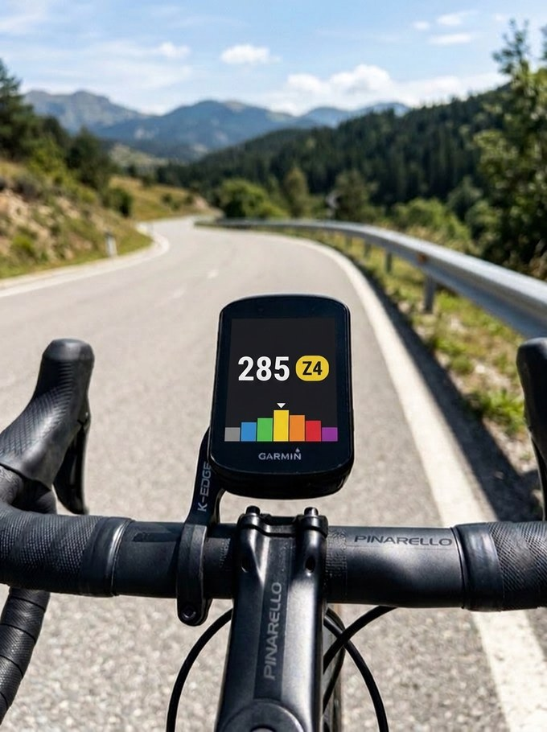
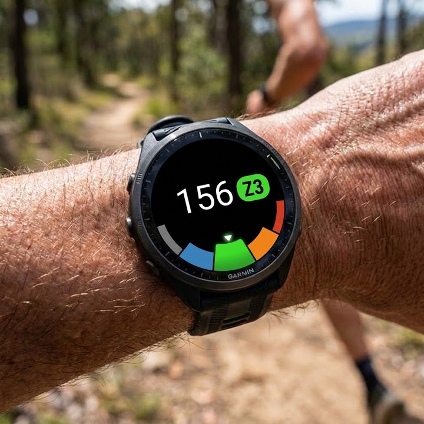
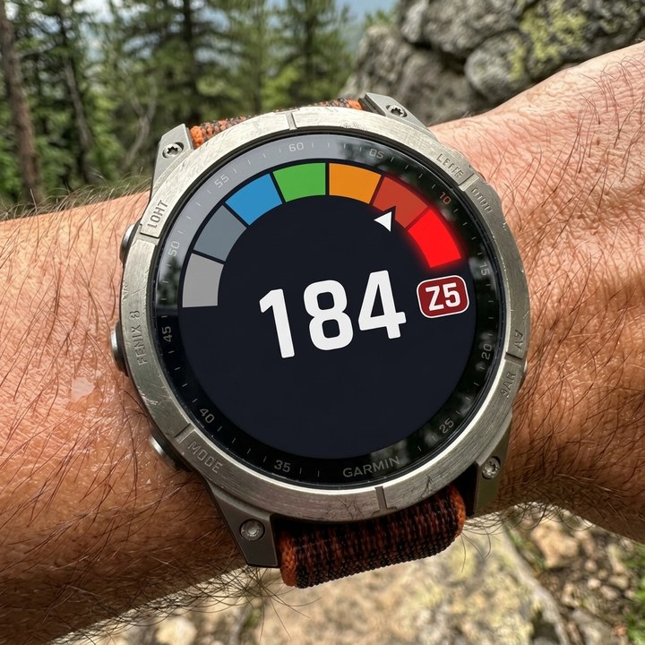

# Zones — Garmin Connect IQ Data Field

A high-performance Garmin Connect IQ Data Field that provides instant, glanceable training zone feedback with a bottom-docked horizontal stacked bar chart showing time spent in zones, a real-time within-zone position indicator, and a prominent hero value with inline color-coded zone badge for both **Heart Rate** and **Power**.

Designed to adapt seamlessly across **Garmin Edge bike computers** (rectangular grids) and **Garmin wearable watches** (round AMOLED/MIP screens with bezel-curved arc adaptations).

---

## Features

* **Supported Metrics:**
  * **Heart Rate (Default):** Standard 5-Zone model utilizing sport-specific thresholds and Max HR directly from your Garmin Connect user profile.
  * **Power (Cycling):** Dr. Andrew Coggan 7-Zone model calculated from your Functional Threshold Power (FTP).
* **Bottom Horizontal Stacked Bar Chart (Time-in-Zone):**
  * **Proportional Segments:** Segments reflect percentage of total session time spent in each zone (5 for Heart Rate, 7 for Power).
  * **Elevated Active Segment:** The active training zone segment is raised slightly higher than inactive segments while remaining flush to the bottom.
  * **Initial & Zero-Time Protection:** Starts with balanced baseline widths and guarantees a minimum visible width whenever entering a zone for the first time.
* **Real-Time Within-Zone Position Indicator:**
  * Directly above the elevated active segment, a dynamic downward-pointing caret indicator (`▼`) pinpoints exactly where the current measured value sits between the active zone's lower and upper boundaries.
* **Hero Value & Inline Active Zone Badge:**
  * Displays the live measured value in large, bold digits without distracting unit labels.
  * Inline to the right of the value, a large rounded badge clearly highlights the active zone (e.g. `Z2` or `Z4`) with vibrant zone color fill and automatic high-contrast typography.
* **Dynamic Form Factor Adaptation for Wearables:**
  * **Rectangular Displays (Edge Series):** Bottom-docked horizontal stacked bar, elevated active segment, indicator, and centered hero value + inline badge.
  * **Circular Watch Displays (Fenix, Forerunner, Epix):**
    * **Top Half Screen (`OBSCURE_TOP`):** Stacked bar pinned to the top bezel curve as an arc with radially thicker active segment, indicator caret, and hero value + badge below.
    * **Bottom Half Screen (`OBSCURE_BOTTOM`):** Stacked bar pinned along the bottom bezel curve with elevated active segment, indicator above, and hero value + badge above.
    * **Full Circular Screen (1-Field):** Pinned bottom bezel arc with indicator and centered hero value + inline badge.
    * **Middle Band:** Bottom-docked horizontal stacked bar with indicator and hero value + badge above.
* **Dark Mode & Light Mode Support:**
  * Automatic detection based on device profile, or force Dark Mode / Light Mode via app settings.
* **Cross-Device Responsive Design:**
  * **Edge Bike Computers:** Optimized rectangular 1, 2, 4, 8, and 10-field grids.
  * **Wearable Watches:** Dedicated polar circular and quadrant layouts without text clipping.
* **Full Localization:**
  * English (`en` / `eng`)
  * German (`de` / `deu`)

---

## Device Screenshots

| Garmin Edge 1040 (Cycling Power) | Garmin Forerunner 970 (Running HR) | Garmin Fenix 8 (Top Half Split) |
| :---: | :---: | :---: |
|  |  |  |
| *Edge 1040 with Coggan Z4 Power, elevated yellow segment & caret indicator* | *Forerunner 970 with Z3 HR, bottom arc stacked bar & indicator* | *Fenix 8 with pinned top arc stacked bar & hero value below* |

---

## Training Zone Models

### Heart Rate Zones (5-Zone Model)
*Sourced dynamically from Garmin Connect profile via `Toybox.UserProfile.getHeartRateZones()`:*

| Zone | Name | Typical % Max HR | Color |
| :---: | :--- | :---: | :--- |
| **Z0** | Warm-Up / Below Zone 1 | $< 50\%$ | Light Gray |
| **Z1** | Warm Up / Active Recovery | $50\% - 59\%$ | Dark Gray |
| **Z2** | Easy / Aerobic Base | $60\% - 69\%$ | Blue |
| **Z3** | Aerobic / Tempo | $70\% - 79\%$ | Dark Green (High Contrast) |
| **Z4** | Threshold | $80\% - 89\%$ | Orange |
| **Z5** | Maximum / VO2 Max | $\ge 90\%$ | Red |

### Power Zones (Coggan 7-Zone Model)
*Calculated from user FTP (auto-detected via UserProfile or custom app setting):*

| Zone | Description | % of FTP | Color |
| :---: | :--- | :---: | :--- |
| **Z1** | Active Recovery | $< 55\%$ | Light Gray |
| **Z2** | Endurance | $55\% - 75\%$ | Blue |
| **Z3** | Tempo | $76\% - 90\%$ | Dark Green (High Contrast) |
| **Z4** | Lactate Threshold | $91\% - 105\%$ | Yellow |
| **Z5** | VO2 Max | $106\% - 120\%$ | Orange |
| **Z6** | Anaerobic Capacity | $121\% - 150\%$ | Red |
| **Z7** | Neuromuscular Power | $> 150\%$ | Purple |

---

## App Settings (Garmin Connect Mobile / Express)

All settings can be adjusted in the Garmin Connect Mobile app or Garmin Express without restarting your activity:

| Setting Key | Options / Range | Default | Description |
| :--- | :--- | :---: | :--- |
| **Metric** | `Heart Rate` (0) / `Power` (1) | Heart Rate | Primary metric tracked |
| **Theme Mode** | `Auto (Follow Device)` (0) / `Dark Mode` (1) / `Light Mode` (2) | Auto | Dark Mode vs Light Mode appearance |
| **FTP (Watts)** | `50` – `600` Watts | 250 W | Functional Threshold Power |
| **Color Style** | `Accent Badge` / `Full Background Fill` | Accent Badge | Full screen coloring vs. accent pill |

---

## Project Structure

```text
ZoneField/
├── .vscode/
│   ├── launch.json              # 1-click debugging configurations (Edge, Forerunner, Fenix)
│   └── settings.json            # Connect IQ developer key configuration
├── assets/                      # Store graphics & device screenshots
│   ├── cover.png                # 500x500 Connect IQ Store App Icon
│   ├── hero.png                 # 1440x720 Connect IQ Store Hero Banner
│   └── screenshots/             # High-resolution device screenshots (<150KB JPEG)
│       ├── screenshot_edge1040_power.jpg
│       ├── screenshot_forerunner970_hr.jpg
│       └── screenshot_fenix8_fullbg.jpg
├── bin/                         # Compiled binaries (.prg) and store bundles (.iq)
├── resources/                   # Base resources & default strings (English)
│   ├── drawables/               # 40x40 base launcher icon
│   ├── settings/                # properties.xml and settings.xml
│   └── strings/                 # strings.xml
├── resources-eng/               # Explicit English string translations
│   └── strings/strings.xml
├── resources-deu/               # German string translations (Deutsch)
│   └── strings/strings.xml
├── resources-edge1040/          # Native 40x40 launcher icon for Edge 1040
├── resources-edge1050/          # Native 68x68 launcher icon for Edge 1050
├── resources-edge830/           # Native 35x35 launcher icon for Edge 830/840/530/540
├── resources-fenix843mm/        # Native 60x60 launcher icon for Fenix 8
├── resources-fr970/             # Native 65x65 launcher icon for Forerunner 970 / 965
├── source/
│   ├── ZoneCalculator.mc        # HR & 7-zone power math, sport detection, colors
│   ├── ZoneStats.mc             # Cumulative and interval duration tracking
│   ├── ZoneFieldView.mc         # Adaptive multi-layout rendering engine
│   └── ZoneFieldApp.mc          # Application lifecycle & live settings handler
├── build_release.sh             # Production deployment script (generates .iq bundle)
├── build_sim.sh                 # Simulator build helper script
├── developer_key.der            # PKCS#8 DER private developer key
├── manifest.xml                 # Connect IQ app permissions and supported devices
├── monkey.jungle                # Connect IQ build jungle definition
└── README.md
```

---

## Prerequisites

1. **Java Runtime:** OpenJDK 17 or 21 (required by Garmin `monkeyc`):
   ```bash
   brew install openjdk@21
   sudo ln -sfn /opt/homebrew/opt/openjdk@21/libexec/openjdk.jdk /Library/Java/JavaVirtualMachines/openjdk-21.jdk
   ```
2. **Garmin Connect IQ SDK:**
   * Install via Homebrew: `brew install --cask connectiq-sdk-manager`
   * Open the SDK Manager and download the latest SDK (System 7 / SDK 7.x/9.x) and your desired device definitions (Edge 1040, Forerunner 970, etc.).
3. **VS Code / Cursor (Optional):**
   * Install the official **Monkey C** extension from Garmin.

---

## Development & Testing

### Option 1: VS Code / Cursor
Open the project folder, open the **Run & Debug** pane (`Cmd+Shift+D`), select your device (e.g. `Run ZoneField (Edge 1040)` or `Run ZoneField (Forerunner 970)`), and press **`F5`**.

### Option 2: Terminal Helper Script
Build and run directly from the command line:

```bash
# Build for Edge 1040:
./build_sim.sh edge1040

# Build and launch in simulator:
./build_sim.sh edge1040 run

# Build for Forerunner 970:
./build_sim.sh fr970 run
```

### Feeding Sensor Data in the Simulator
1. **Start Activity Timer:** Press the device's physical `START / STOP` button or press **`F7`** in the simulator to activate time accumulation.
2. **Simulate Sensors:** Open **Simulation $\rightarrow$ Activity Data...** and drag the **Heart Rate** or **Power** sliders to watch zone colors, inline zone badges, indicator caret, and stacked bar segments react in real time.
3. **Test App Settings:** Open **File $\rightarrow$ Edit Persistent Storage $\rightarrow$ Edit Application Properties Data** to toggle between Heart Rate and Power mode or change FTP.

---

## Building for the Connect IQ Store

To create a signed, upload-ready application bundle (`.iq` file) containing optimized release binaries for all configured devices:

```bash
./build_release.sh
```

This compiles with release optimizations (`-r`) and packages the bundle into `bin/ZoneField.iq`:

```text
======================================================
  ✓ SUCCESS: Application bundle created successfully! 
======================================================
File: bin/ZoneField.iq (84K)

Packaged Target Devices:
  • edge1040
  • edge1050
  • edge830
  • fenix843mm
  • fr970
```

Upload `bin/ZoneField.iq` directly to the [Garmin Connect IQ Developer Dashboard](https://apps.garmin.com/developer/dashboard).

---

## License

MIT License. Designed and developed for Garmin Connect IQ devices.
